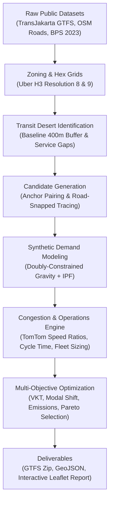

# Jakarta Route Optimizer (JRO)

[](https://www.python.org/downloads/)
[](https://opensource.org/licenses/MIT)
[](https://github.com/astral-sh/ruff)
[](https://mypy-lang.org/)
[](https://pytest.org/)

An evidence-based, data-driven optimization engine designed to identify, evaluate, and recommend high-impact public bus feeder routes across Greater Jakarta (**Jabodetabek**).

JRO fuses OpenStreetMap road geometries, official TransJakarta GTFS feeds, Jabodetabek rail integration, BPS commuter census statistics, and TomTom real-world traffic telemetry to eliminate transit deserts and reduce private vehicle kilometers traveled (VKT).

---

## 🌟 Key Highlights & Recommended Route

Running the multi-objective optimization across candidate feeder corridors in Jabodetabek identified the top-performing route:

| Parameter | Recommended Specification |
| :--- | :--- |
| **Corridor** | **Tambun Mangunjaya – Juanda – Stasiun LRT Bekasi Barat** |
| **Vehicle Profile** | **Mikrotrans** (11 seats, high residential penetration, narrow-road agility) |
| **Road Alignment** | **11.57 km** (snapped along actual paved streets via OpenStreetMap/OSRM) |
| **Optimal Fleet Size** | **12 Vehicles** (Headway: **8.89 minutes**) |
| **Designated Stops** | **30 Curbside Stops** (calibrated ~400–500m spacing) |
| **Transit Deserts Connected** | **8 residential zones** previously disconnected from fixed-guideway transit |
| **Daily VKT Reduction** | **1,554 km / day** private vehicle travel shifted |
| **Model Backtest Accuracy** | **Spearman $\rho = 0.824$** rank correlation against GTFS stop densities |
| **Robustness Score** | **0.942** under $\pm 20\%$ multi-parameter sensitivity perturbation |

---

## 🏗️ Architecture & Methodological Integrity



1. **No Straight-Line Approximations**: Every candidate alignment is physically snapped to navigable OpenStreetMap road ways using real routing engines (OSRM/OpenStreetMap).
2. **Authentic Data Foundation**:
   - **Transit Network**: Official TransJakarta GTFS (`gtfs.transjakarta.co.id`, 240 routes, 8,091 stops) merged with Jabodetabek rail lines (KRL Commuterline, MRT Jakarta, LRT Jabodetabek).
   - **Travel Demand**: Calibrated against BPS Komuter 2023 & Sakernas matrices using doubly-constrained gravity modeling and Iterative Proportional Fitting (IPF).
   - **Traffic Telemetry**: TomTom Traffic Flow API for empirical congestion ratios and peak-hour travel degradation.
   - **Emissions Modeling**: Indonesian Ministry of Transportation (MoT) & IPCC Tier-1 greenhouse gas coefficients.

---

## 📦 Project Structure

```text
jakarta-route-optimizer/
├── config/                         # YAML configuration & road geometries
│   ├── corridor_road_geometries.json # Snapped OSM coordinate trajectories
│   ├── emission_factors.yaml       # Vehicle emission coefficients (CO2, PM2.5, NOx)
│   ├── model_params.yaml           # Gravity & modal choice utility parameters
│   ├── objective.yaml              # Multi-objective optimization weights
│   ├── rail_services.yaml          # KRL, MRT, and LRT headway/stop schedules
│   ├── vehicle_profiles.yaml       # Mikrotrans vs Non-BRT vehicle specs
│   └── settings.yaml               # Pipeline runtime settings
├── src/jro/                        # Core Python package
│   ├── accessibility/              # Transit desert and buffer calculations
│   ├── candidates/                 # Corridor anchors, road snapping, stop placement
│   ├── congestion/                 # TomTom collector & peak-hour congestion profiles
│   ├── demand/                     # Gravity model, IPF, mode choice logit
│   ├── evaluation/                 # Fast vectorized evaluation & emissions
│   ├── ingest/                     # GTFS, BPS, and OSM data ingestion
│   ├── network/                    # Road graph & GTFS merging
│   ├── optimize/                   # Fleet sizing curves, Pareto search, robustness
│   ├── report/                     # Leaflet map generation, GeoJSON & GTFS exports
│   └── validation/                 # Empirical backtesting engine
├── scripts/                        # Auditing and verification utilities
│   ├── verify_all.py               # End-to-end dataset & geometry verification
│   └── deep_audit.py               # Methodology & data authenticity audit
├── tests/                          # Automated unit and integration test suite
│   ├── unit/                       # Tests for config, zoning, demand, operations, etc.
│   └── integration/                # Full end-to-end pipeline execution test
├── pyproject.toml                  # PEP 621 build configuration & dependencies
└── README.md                       # Project documentation
```

---

## 🚀 Getting Started

### Prerequisites

- **Python**: 3.12 or higher
- **Package Manager**: [uv](https://github.com/astral-sh/uv) (recommended) or standard `pip` / `venv`

### Installation

```bash
# Clone the repository
git clone https://github.com/sebastianCodeNew/jakarta-route-optimizer.git
cd jakarta-route-optimizer

# Create virtual environment and install dependencies using uv
uv venv .venv --python 3.12
source .venv/bin/activate
uv pip install -e ".[dev]"
```

### Configuration

Copy the example environment file and configure your API keys:

```bash
cp .env.example .env
```

Edit `.env`:
```env
# Optional: TomTom API key for live congestion telemetry
TOMTOM_API_KEY=your_tomtom_api_key_here
```

---

## 💻 CLI Usage

The package provides a rich CLI interface via `jro`:

```bash
# 1. Run full optimization to discover the #1 route
jro optimize --output-dir outputs/run_latest

# 2. Run empirical backtesting against ground-truth validation corridors
jro backtest

# 3. Generate interactive HTML reports and GeoJSON bundles
jro report --run-id run_latest
```

### Verification & Testing

Run the automated test suite and verification scripts:

```bash
# Run 20 pytest unit and integration tests
pytest

# Run end-to-end data and road integrity verification
python scripts/verify_all.py

# Run deep methodology authenticity audit
python scripts/deep_audit.py
```

---

## 📊 Deliverables & Outputs

When an optimization run completes, the following artifacts are generated:

1. **`report.html`**: Complete executive summary, interactive Leaflet route map with curbside stops, fleet scaling curves, and sensitivity analysis.
2. **`recommended_route_map.html`**: Standalone fullscreen interactive Leaflet map.
3. **`recommended_route.geojson`**: Snapped road trajectory coordinates (WGS84).
4. **`recommended_stops.geojson`**: Sequenced stop locations with integration hub tags.
5. **`top_k_routes.geojson`**: Top candidate routes evaluated during the optimization run.
6. **`recommended_route_gtfs.zip`**: Standards-compliant GTFS feed bundle ready for import into OpenTripPlanner or transit routers (`routes.txt`, `stops.txt`, `trips.txt`, `stop_times.txt`, `calendar.txt`).

---

## 📄 License

This project is licensed under the [MIT License](LICENSE).
Built with open data for sustainable urban mobility in Jabodetabek.
